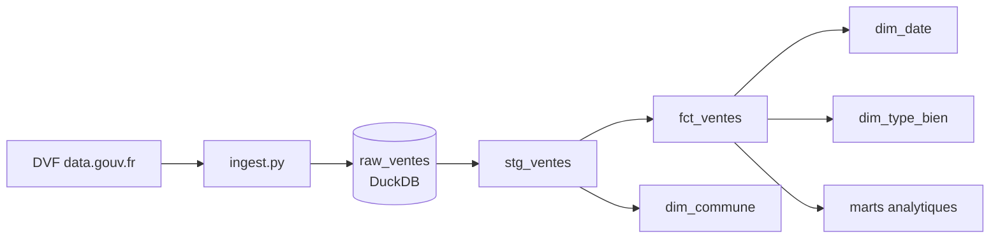

# dvf-warehouse

Entrepôt analytique des ventes immobilières du Grand Est, construit avec **dbt** et **DuckDB**.

Les données publiques [DVF](https://www.data.gouv.fr/fr/datasets/demandes-de-valeurs-foncieres-geolocalisees/) (toutes les ventes immobilières réelles) sont chargées dans un entrepôt DuckDB, puis transformées par dbt en un **schéma en étoile** testé et documenté.



## Modèle en étoile

| Modèle | Rôle |
|---|---|
| `stg_ventes` | Nettoyage et typage du brut (texte → dates, nombres) |
| `fct_ventes` | **Faits** : une vente d'un logement unique, avec le prix au m² calculé |
| `dim_commune` | Dimension commune (+ nom du département) |
| `dim_date` | Dimension date (année, mois, trimestre) |
| `dim_type_bien` | Dimension type de bien (maison / appartement) |
| `mart_prix_m2_commune` | Prix au m² médian par commune et par année |
| `mart_ventes_mensuelles` | Volume et prix au m² médian par mois |

## Lancer le projet

Il faut Docker.

```bash
# 1. Charger les données (télécharge DVF, filtre le Grand Est)
docker compose run --rm ingest

# 2. Construire le schéma en étoile et lancer les tests
docker compose run --rm dbt build

# 3. Générer la documentation + le graphe de lineage
docker compose run --rm dbt docs generate
```

Choisir les années à charger : `docker compose run --rm -e INGEST_YEARS=2022,2023,2024 ingest`.

## Note sur les données

DVF **ne couvre pas l'Alsace ni la Moselle** (départements 67, 68, 57) : ces territoires relèvent du *livre foncier* d'Alsace-Moselle (droit local), et leurs ventes ne sont pas publiées dans DVF. Le périmètre retenu est donc le reste du Grand Est.

## Choix de modélisation

- **Grain de la table de faits** : une vente d'un seul logement. Une mutation DVF peut couvrir plusieurs biens, et la valeur foncière est globale à la mutation ; on écarte donc les mutations multi-biens pour que le prix au m² ait un sens.
- **Qualité** : les tests dbt vérifient l'unicité des clés, les valeurs attendues (`Maison` / `Appartement`) et l'**intégrité référentielle** entre `fct_ventes` et `dim_commune`.
- **Séparation des couches** : `staging` (vues, nettoyage) puis `marts` (tables, modèle métier), comme dans un vrai projet analytics engineering.

## Stack

Python · DuckDB · dbt · Docker
